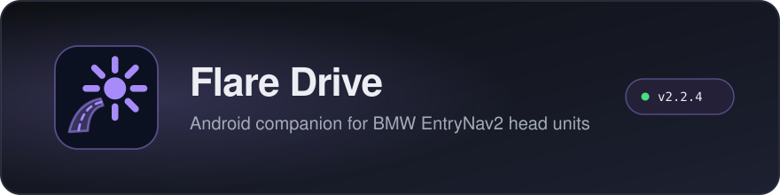

<p align="center">
  
</p>

<p align="center">
  Install, update, and configure Android Auto and compatible iDrive plugins on a BMW EntryNav2 head unit straight from your Android phone.
</p>

<p align="center">
  <a href="https://github.com/CallMeLewis/flare-drive-app/releases/latest"><strong>Download Latest APK (v2.2.9)</strong></a>
  &nbsp;&middot;&nbsp;
  <a href="#requirements">Requirements</a>
  &nbsp;&middot;&nbsp;
  <a href="#getting-started">Getting started</a>
  &nbsp;&middot;&nbsp;
  <a href="#verifying-the-apk">Verify SHA-256</a>
  &nbsp;&middot;&nbsp;
  <a href="CHANGELOG.md">Changelog</a>
</p>

---

## Download

Get the signed Android APK from [**Releases**](https://github.com/CallMeLewis/flare-drive-app/releases/latest).

| | |
|---|---|
| **Latest version** | `2.2.9` (Android 8.0 / API 26 or newer) |
| **File** | `flare-drive-2.2.9.apk` (3.55 MB) |
| **APK SHA-256** | `14b3b33a321b0728f49408bef3e783181af4580625576870984f9cdbf8545864` |
| **Signing cert SHA-256** | `55772e3608c3cc9a41dd0617a8d26323bd3e34f09df41bb3a25124989bc72bf5` |

> [!NOTE]
> This repository hosts Flare Drive's public releases, documentation, and issue tracker. The app is distributed directly as a signed APK.

## What it does

- **Verified plugin installs and updates** — Download signed plugin releases while you have internet, then install, update, or cleanly remove them once connected to your car.
- **Android Auto settings without SSH commands** — Change start-up behaviour, USB or wireless connection, audio routing, cluster navigation, and vehicle details with a review step before applying.
- **Companion iDrive plugins** — Manage Android Auto alongside compatible EntryNav2 plugins from the Plugins tab.
- **ENET cable or car Wi-Fi** — Finds the head unit automatically over an ENET cable with USB Ethernet tethering, or over the car's Wi-Fi using the QR code shown in iDrive.
- **Offline diagnostics and help** — Toggle service logging, view live logs, export diagnostic reports, take a read-only system copy to your phone or a USB stick, and read built-in troubleshooting without mobile signal.
- **Local-only credentials and app lock** — No default password is built in. Saving your SSH password on the phone is optional, encrypted with Android Keystore, and excluded from cloud backups. Optional PIN, fingerprint, or face lock is available under **Settings › Security**.

## Requirements

| Requirement | Details |
|---|---|
| **Android phone** | Android 8.0 (Oreo) or newer. On Android 17+, allow **Nearby devices** when prompted so the app can reach the head unit on the local network. |
| **Head unit** | A BMW **EntryNav2** head unit with **SSH access already enabled** and its root password. Flare Drive does not enable SSH or bypass factory protections. |
| **First connection** | An **ENET cable** and a **USB Ethernet adapter** for your phone, with Ethernet tethering turned on in your phone's hotspot and tethering settings. |
| **Car Wi-Fi** *(optional)* | Once Android Auto is installed, scan the QR code under **Media › Android Auto › Flare Drive** in iDrive to connect without the ENET cable. |

## Getting started

1. **Install the APK** — Download `flare-drive-2.2.9.apk` from [**Releases**](https://github.com/CallMeLewis/flare-drive-app/releases/latest) on your phone, open it, and allow installing unknown apps if Android prompts.
2. **Download plugin releases while online** — Open **Plugins** before heading to the car and fetch the latest releases while you have internet access.
3. **Connect in a parked car** — Plug in the ENET cable with ignition on and Ethernet tethering enabled. Tap the connection chip at the top of the screen and enter your head unit's root password (enable **Save password on this phone** if you want it stored encrypted locally).

> [!IMPORTANT]
> Keep the car parked with the ignition on while installing, updating, or restarting the head unit. Do not unplug the cable until Flare Drive confirms the operation has finished.

## Verifying the APK

Every release includes a matching `.sha256` file. To verify `flare-drive-2.2.9.apk` before installing:

**Linux / macOS:**
```sh
sha256sum -c flare-drive-2.2.9.apk.sha256
```

**Windows (PowerShell):**
```powershell
(Get-FileHash -Algorithm SHA256 .\flare-drive-2.2.9.apk).Hash.ToLower()
```

Confirm the hash matches `14b3b33a321b0728f49408bef3e783181af4580625576870984f9cdbf8545864`. Future updates are signed with the same release key (`55772e3608c3cc9a41dd0617a8d26323bd3e34f09df41bb3a25124989bc72bf5`), so Android verifies upgrades automatically.

## Common questions

<details>
<summary>Does Flare Drive enable SSH on my BMW head unit?</summary>

No. Your EntryNav2 head unit must already have SSH enabled and you must know its root password.
</details>

<details>
<summary>Where is my SSH password stored?</summary>

By default, only in memory for the current session. If you switch on **Save password on this phone**, Flare Drive encrypts it on-device using Android Keystore (AES-256-GCM) and excludes it from cloud backups and device transfers. Turning the switch off deletes it immediately.
</details>

<details>
<summary>Does Flare Drive need internet access in the car?</summary>

No. Download plugin releases while online first; connecting to the head unit, installing, changing settings, diagnostics, and Help all work offline.
</details>

<details>
<summary>What happens if a plugin causes iDrive to restart?</summary>

A built-in crash guard disables the plugin automatically if iDrive restarts three times within two minutes, allowing iDrive to start normally without it. You can turn the plugin back on or remove it cleanly from Flare Drive.
</details>

<details>
<summary>Does the app collect analytics or telemetry?</summary>

Not by default. There are no accounts, no tracking, and no automatic log uploads. An optional **Share compatibility results** switch under **Settings › About** (off by default) lets you send anonymous pass/fail compatibility data — firmware version, iDrive version, car series, plugin version, app version, and outcome — to help verify which EntryNav2 firmware versions work with each plugin. No VIN, password, IP address, or logs are ever sent, and switching it off deletes any unsent reports immediately.
</details>

## Disclaimer & Licences

Flare Drive is an independent app and is not affiliated with BMW AG or Google LLC. Installing software on a vehicle head unit is at your own risk.

Third-party open-source notices (IBM Plex, Lucide, JSch, Bouncy Castle, AndroidX, and Kotlin) are included inside the app under **Settings › About › Licences**.
